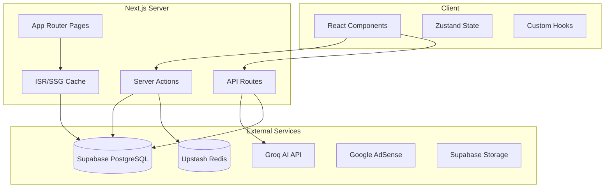
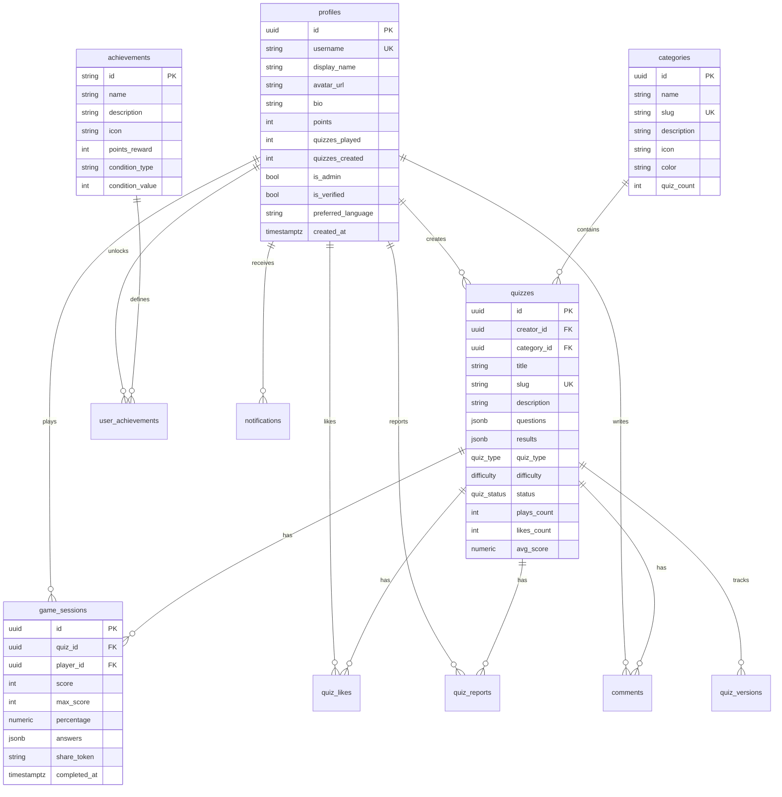
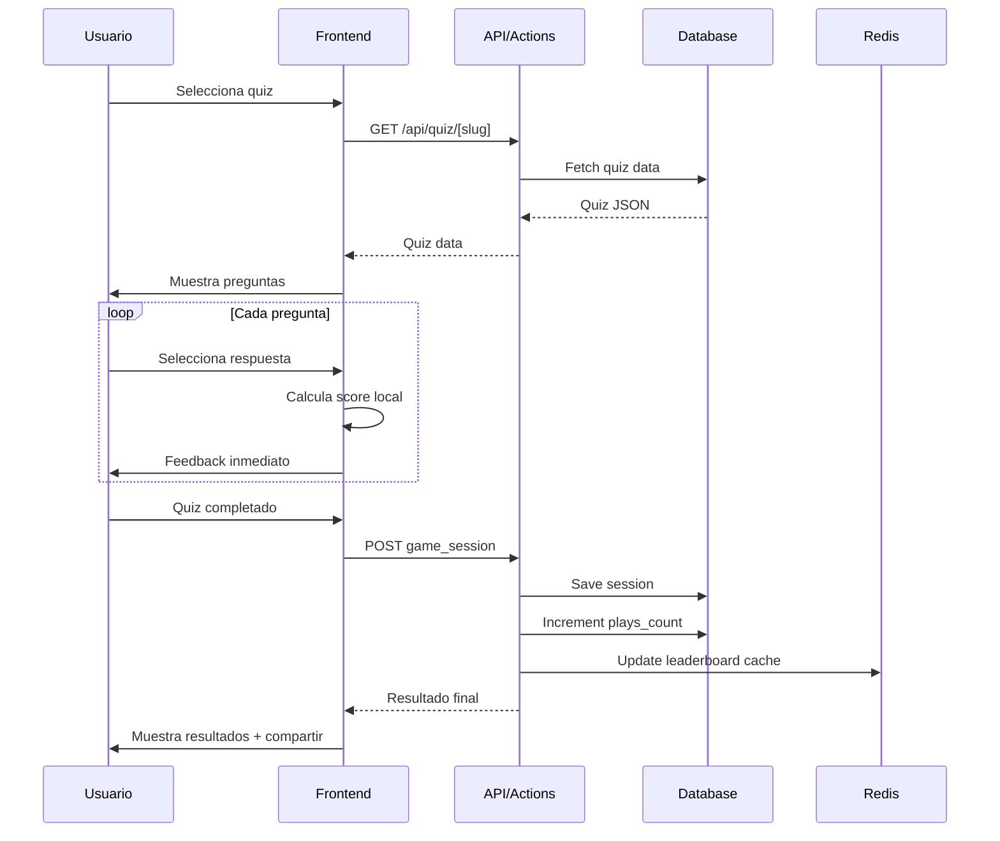

# QuizVerse - Plan de Arquitectura Masivo

## Resumen Ejecutivo

QuizVerse es una plataforma de quizzes construida con Next.js 16, Supabase, y AI (Groq). El proyecto tiene una base sólida pero requiere completar funcionalidades clave, conectar el frontend con la base de datos real, y agregar características de producción.

## Estado Actual del Proyecto

### Lo que funciona
- Estructura de carpetas bien organizada con Next.js App Router
- Schema de base de datos completo con migraciones
- RLS policies configuradas
- UI components con design system "Cosmic Playground"
- Mock data para demostración
- AI Quiz Generator con Groq (estructura base)
- Sistema de ads con AdSense (estructura base)
- Rate limiting con Upstash Redis

### Lo que falta
- Conexión real frontend-database (actualmente usa mock data)
- Autenticación funcional completa
- Quiz engine conectado a Supabase
- Sistema social (likes, comentarios, compartir)
- Panel de administración
- Testing
- SEO completo
- Internacionalización
- Accesibilidad

---

## Arquitectura del Sistema



## Diagrama de Base de Datos



## Flujo de Juego



---

## Plan de Implementación por Fases

### FASE 1: Infraestructura y Configuración
**Objetivo:** Tener un entorno de desarrollo robusto y reproducible

**Prioridad:** CRITICA
**Dependencias:** Ninguna

**Entregables:**
- `.env.example` con todas las variables documentadas
- Script `npm run setup` automatizado
- Husky + lint-staged configurados
- GitHub Actions CI/CD
- Docker Compose para desarrollo local

### FASE 2: Base de Datos y Migraciones
**Objetivo:** Schema completo con todas las tablas necesarias

**Prioridad:** CRITICA
**Dependencias:** FASE 1

**Nuevas tablas a agregar:**
```sql
-- Comentarios
CREATE TABLE comments (
  id UUID PRIMARY KEY DEFAULT uuid_generate_v4(),
  quiz_id UUID REFERENCES quizzes(id) ON DELETE CASCADE,
  user_id UUID REFERENCES profiles(id) ON DELETE SET NULL,
  parent_id UUID REFERENCES comments(id) ON DELETE CASCADE,
  content TEXT NOT NULL CHECK (char_length(content) <= 1000),
  likes_count INT DEFAULT 0,
  created_at TIMESTAMPTZ DEFAULT NOW(),
  updated_at TIMESTAMPTZ DEFAULT NOW()
);

-- Notificaciones
CREATE TABLE notifications (
  id UUID PRIMARY KEY DEFAULT uuid_generate_v4(),
  user_id UUID REFERENCES profiles(id) ON DELETE CASCADE,
  type TEXT NOT NULL,
  title TEXT NOT NULL,
  message TEXT NOT NULL,
  link TEXT,
  is_read BOOLEAN DEFAULT FALSE,
  created_at TIMESTAMPTZ DEFAULT NOW()
);

-- Versiones de quizzes
CREATE TABLE quiz_versions (
  id UUID PRIMARY KEY DEFAULT uuid_generate_v4(),
  quiz_id UUID REFERENCES quizzes(id) ON DELETE CASCADE,
  version INT NOT NULL,
  questions JSONB NOT NULL,
  results JSONB,
  created_at TIMESTAMPTZ DEFAULT NOW()
);

-- Seguidores
CREATE TABLE follows (
  follower_id UUID REFERENCES profiles(id) ON DELETE CASCADE,
  following_id UUID REFERENCES profiles(id) ON DELETE CASCADE,
  created_at TIMESTAMPTZ DEFAULT NOW(),
  PRIMARY KEY (follower_id, following_id)
);
```

### FASE 3: Autenticación y Perfiles
**Objetivo:** Sistema de auth completo con perfiles públicos

**Prioridad:** CRITICA
**Dependencias:** FASE 2

**Componentes a crear:**
- `src/app/(auth)/register/page.tsx`
- `src/app/(auth)/verify-email/page.tsx`
- `src/app/settings/page.tsx`
- `src/app/settings/profile/page.tsx`
- `src/app/settings/account/page.tsx`
- `src/components/auth/auth-form.tsx`
- `src/components/auth/username-checker.tsx`
- `src/components/settings/avatar-upload.tsx`

### FASE 4: Quiz Engine Completo
**Objetivo:** Motor de juego funcional conectado a DB real

**Prioridad:** CRITICA
**Dependencias:** FASE 2, FASE 3

**Cambios clave:**
1. Reemplazar `getQuizBySlug()` mock con query real a Supabase
2. Guardar `game_sessions` al completar quiz
3. Agregar animaciones con Framer Motion entre preguntas
4. Implementar sistema de power-ups
5. Agregar modos de juego adicionales

**Estado del QuizPlayer:**
```typescript
interface QuizGameState {
  quiz: Quiz;
  currentQuestion: number;
  answers: Answer[];
  score: number;
  streak: number;
  powerUps: PowerUp[];
  timeRemaining: number;
  isCompleted: boolean;
  mode: 'normal' | 'timed' | 'survival' | 'practice';
}
```

### FASE 5: Creación de Quizzes
**Objetivo:** Experiencia completa de creación

**Prioridad:** ALTA
**Dependencias:** FASE 3, FASE 4

**Componentes:**
- `src/components/quiz/quiz-creator-form.tsx` (completar)
- `src/components/quiz/question-editor.tsx`
- `src/components/quiz/quiz-preview.tsx`
- `src/components/quiz/drag-drop-questions.tsx`
- `src/components/quiz/csv-import.tsx`

### FASE 6: Social y Comunidad
**Objetivo:** Engagement y viralidad

**Prioridad:** ALTA
**Dependencias:** FASE 3, FASE 4

**Features:**
- Likes con optimistic updates
- Comentarios con hilos
- Share images generadas con satori
- Sistema de desafíos
- Feed de actividad
- Achievements automáticos

### FASE 7: Administración
**Objetivo:** Herramientas de moderación

**Prioridad:** MEDIA
**Dependencias:** FASE 3, FASE 6

**Rutas:**
- `/admin/dashboard`
- `/admin/moderation`
- `/admin/reports`
- `/admin/categories`
- `/admin/users`
- `/admin/analytics`

### FASE 8: SEO y Descubrimiento
**Objetivo:** Tráfico orgánico

**Prioridad:** ALTA
**Dependencias:** FASE 2

**Implementación:**
- Sitemap dinámico
- JSON-LD en todas las páginas
- OG images dinámicas
- Breadcrumbs con schema
- Búsqueda full-text

### FASE 9: Rendimiento
**Objetivo:** Core Web Vitals óptimos

**Prioridad:** ALTA
**Dependencias:** Todas las anteriores

**Estrategia:**
- ISR para quizzes populares
- Redis cache para queries frecuentes
- Image optimization
- Code splitting
- Streaming SSR

### FASE 10-16: Completar según plan

---

## Estructura de Carpetas Final

```
quizverse/
├── .github/
│   └── workflows/
│       ├── ci.yml
│       └── deploy.yml
├── docker/
│   ├── docker-compose.yml
│   └── Dockerfile
├── plans/
│   └── ARCHITECTURE-PLAN.md
├── public/
│   ├── locales/
│   │   ├── en/
│   │   ├── es/
│   │   └── ...
│   └── ...
├── scripts/
│   ├── seed-quizzes.ts
│   ├── seed-achievements.ts
│   └── setup.ts
├── src/
│   ├── actions/
│   │   ├── admin.actions.ts
│   │   ├── auth.actions.ts
│   │   ├── comment.actions.ts
│   │   ├── like.actions.ts
│   │   ├── profile.actions.ts
│   │   ├── quiz.actions.ts
│   │   ├── report.actions.ts
│   │   └── share.actions.ts
│   ├── app/
│   │   ├── (auth)/
│   │   │   ├── login/
│   │   │   ├── register/
│   │   │   ├── verify-email/
│   │   │   └── callback/
│   │   ├── (marketing)/
│   │   ├── admin/
│   │   │   ├── dashboard/
│   │   │   ├── moderation/
│   │   │   ├── reports/
│   │   │   ├── categories/
│   │   │   ├── users/
│   │   │   └── analytics/
│   │   ├── api/
│   │   ├── category/
│   │   ├── create/
│   │   ├── leaderboard/
│   │   ├── profile/
│   │   ├── quiz/
│   │   ├── settings/
│   │   │   ├── profile/
│   │   │   ├── account/
│   │   │   └── notifications/
│   │   ├── layout.tsx
│   │   ├── page.tsx
│   │   ├── error.tsx
│   │   ├── loading.tsx
│   │   └── not-found.tsx
│   ├── components/
│   │   ├── admin/
│   │   ├── ads/
│   │   ├── auth/
│   │   ├── comments/
│   │   ├── home/
│   │   ├── layout/
│   │   ├── profile/
│   │   ├── quiz/
│   │   ├── settings/
│   │   ├── shared/
│   │   └── ui/
│   ├── config/
│   │   ├── achievements.ts
│   │   ├── badges.ts
│   │   └── powerups.ts
│   ├── i18n/
│   │   ├── request.ts
│   │   └── routing.ts
│   ├── lib/
│   │   ├── ads/
│   │   ├── analytics/
│   │   ├── auth/
│   │   ├── cache/
│   │   ├── data/
│   │   ├── hooks/
│   │   ├── quiz/
│   │   ├── seo/
│   │   ├── supabase/
│   │   └── utils/
│   ├── providers/
│   │   ├── supabase-provider.tsx
│   │   ├── theme-provider.tsx
│   │   ├── toast-provider.tsx
│   │   └── i18n-provider.tsx
│   ├── stores/
│   │   ├── quiz-store.ts
│   │   └── ui-store.ts
│   ├── types/
│   │   ├── database.ts
│   │   ├── quiz.ts
│   │   └── index.ts
│   └── middleware.ts
├── supabase/
│   ├── migrations/
│   │   ├── 001_initial_schema.sql
│   │   ├── 002_rls_policies.sql
│   │   ├── 003_functions.sql
│   │   ├── 004_seed_data.sql
│   │   ├── 005_comments.sql
│   │   ├── 006_notifications.sql
│   │   ├── 007_follows.sql
│   │   └── 008_quiz_versions.sql
│   └── seed/
├── tests/
│   ├── e2e/
│   ├── integration/
│   └── unit/
├── .env.example
├── docker-compose.yml
├── next.config.ts
├── package.json
├── tsconfig.json
└── vitest.config.ts
```

---

## Tecnologías y Dependencias

### Actuales
- Next.js 16.2.1
- React 19.2.4
- TypeScript 5
- Tailwind CSS 4
- Supabase (SSR + JS)
- Upstash Redis
- Groq AI
- Framer Motion
- Zod
- Satori

### A Agregar
- `zustand` - State management global
- `@hookform/resolvers` + `react-hook-form` - Formularios
- `@dnd-kit/core` + `@dnd-kit/sortable` - Drag and drop
- `next-intl` - Internacionalización
- `@sentry/nextjs` - Error tracking
- `vitest` + `@testing-library/react` - Testing
- `@playwright/test` - E2E testing
- `husky` + `lint-staged` - Pre-commit hooks
- `sharp` - Optimización de imágenes
- `sonner` - Toasts mejorados

---

## Métricas de Éxito

| Métrica | Objetivo Actual | Objetivo Final |
|---------|----------------|----------------|
| LCP | N/A | < 2.5s |
| CLS | N/A | < 0.1 |
| INP | N/A | < 200ms |
| Bundle Size | N/A | < 250KB initial |
| Test Coverage | 0% | > 80% |
| Lighthouse SEO | N/A | 100 |
| Lighthouse A11y | N/A | > 95 |
| Time to Interactive | N/A | < 3.5s |

---

## Riesgos y Mitigaciones

| Riesgo | Impacto | Mitigación |
|--------|---------|------------|
| Rate limiting de Groq AI | Alto | Implementar cache de quizzes generados, fallback a mock |
| Costos de Supabase | Medio | Optimizar queries, usar ISR, implementar cache Redis |
| Complejidad del schema | Medio | Migraciones incrementales, testing exhaustivo |
| Performance con muchos quizzes | Alto | Paginación, virtualización, índices optimizados |
| SEO con client-side rendering | Alto | Priorizar SSR/ISR, implementar streaming |

---

## Próximos Pasos Inmediatos

1. **FASE 1** - Configurar infraestructura base
2. **FASE 2** - Completar migraciones de DB
3. **FASE 4.1** - Conectar QuizPlayer con DB real
4. **FASE 3.1** - Completar autenticación

Estos son los bloques fundamentales que habilitan todo lo demás.
